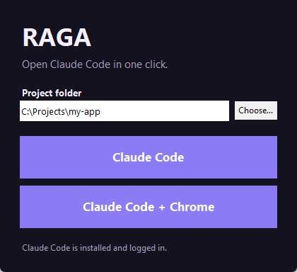

# RAGA

[](https://github.com/RobertReed1412/RAGA/actions/workflows/tests.yml)

**Open Claude Code in one click, and make it learn from every session.**

RAGA is two things in one small, dependency-free Python repo:

1. **A beginner-friendly launcher.** A window with two buttons, **Claude Code** and
   **Claude Code + Chrome**. Pick a folder and press one; a terminal opens there with Claude Code
   running. No commands to remember.
2. **A learning engine.** It turns lessons from past sessions ("when X happens, do Y, because Z")
   into context the agent gets automatically. It proves with A/B evals whether each lesson actually
   helps, gets a second opinion from an **LLM council** built to disagree, and exports everything as
   fine-tuning data.



---

## Try it in 2 minutes (Python only: no account, no install, no cost)

```bash
git clone https://github.com/RobertReed1412/RAGA.git
cd RAGA
python raga.py demo                          # the whole learning loop on made-up data
python -m unittest discover -s tests -v      # 29 tests, under a second
```

Needs Python 3.10+. Everything uses the standard library, so there's nothing to `pip install`.

## Use the launcher

**Double-click `RAGA.pyw`** (Windows), or run:
```bash
python raga.py
```

First time only:
1. **Install Claude Code.** If it's missing, the launcher shows the one-line install command for
   your OS. Windows: `irm https://claude.ai/install.ps1 | iex`. Mac/Linux:
   `curl -fsSL https://claude.ai/install.sh | bash`.
2. **Log in.** Claude Code asks the first time it opens. It needs a paid Claude plan or an API key.
3. **For the Chrome button:** install Google Chrome and the *Claude in Chrome* extension, signed in
   to the same account.

The status line at the bottom says whether Claude Code is installed and logged in.

---

## Real results (measured, not claimed)

| What | Result | How to reproduce |
|---|---|---|
| Tests | 29 pass on Windows 11 (Python 3.14); CI runs them on Windows, macOS and Linux with Python 3.10 and 3.13 | `python -m unittest discover -s tests` |
| Do the tests catch bugs? | 3 safety checks were broken on purpose: redaction, AppleScript escaping, "no invented decisions". 4 tests failed; the restored code passes. | edit one, rerun |
| Live A/B eval, lesson `rerun-failed-only`, real Claude, 2 cases | **Run 1:** without 0.50 → with 0.75 (**+0.25**). **Run 2:** 0.75 → 0.75 (**+0.00**). | `python raga.py eval --live` |
| The demo's eval | +0.83, but **the demo uses a scripted model**: it shows the pipeline works, not that the lesson helps | `python raga.py demo` |

**What the live numbers mean:** Claude already mostly knows this lesson, so it adds little.
That's a useful finding, because a lesson that doesn't lift scores is noise that costs tokens.
Two cases with one answer each is too small a sample to call it either way. The next step is
repeated sampling (see Limits).

---

## How it works

```
 you work in Claude Code
      │
      ├─ session starts ──► hook: top active lessons go into the agent's context
      ├─ you type ────────► hook: only lessons matching your message (keyword retrieval)
      │
 something goes wrong / right
      └─► `raga lesson add` (trial) ──► reinforced twice ──► active   (harmful counts double; retire anytime)
                                              │
 is it actually helping? ──► `raga eval --live`: same prompts with vs. without the lesson → lift
 big decision?           ──► `raga council`: 5 blind advisors → anonymous review → chairman verdict
 later                   ──► `raga export`: SFT + preference pairs + evals + council → train your own model
```

| File | Job |
|---|---|
| `raga.py` | Entry point. No arguments opens the launcher; subcommands run the engine. |
| `raga/launcher.py` | The Tkinter window. It holds no logic of its own. |
| `raga/claude_cli.py` | Finds Claude Code, checks the login, and builds the exact terminal command per OS. |
| `raga/store.py` | Append-only event log (JSONL), with redaction for exports. |
| `raga/lessons.py` | Rebuilds lessons by replaying events; scoring, retrieval, playbook. |
| `raga/evals.py` | A/B evals, deterministic graders, and the real-Claude adapter (`claude -p`). |
| `raga/council.py` | Advisors, blind shuffle, reviewer and chairman prompts, missing-advisor handling. |
| `raga/hooks.py` | Claude Code hook entry points, plus the settings snippet. |
| `raga/export.py` | Training-data export with a manifest. |
| `raga/demo.py` | The scripted, clearly labeled demo. |

### Turn the learning hooks on in your own project

```bash
python raga.py hooks-snippet
```
Paste the printed block into your project's `.claude/settings.json`. From then on, every Claude
Code session there starts with your lessons, and each message pulls in the relevant ones.

---

## How this was built

This repo is a clean extraction of a private system I use daily. It runs two Claude Code agent
teams, one on a Mac (SOL) and one on a Windows desktop (LUNA), which share one learning brain
(RAGA). The private version holds personal data, so this repo was rebuilt from scratch in a fresh
git repo with no shared history, and grepped for personal details before the first commit.

The plan was put through the same council this repo ships. Five advisors answered blind, and
**all five picked "launcher as the front door plus the engine"** over "launcher only" or "add a
dashboard". The top-ranked advisor flagged personal-data leakage as the main risk, which is why
the extraction and grep steps exist. A fresh-eyes review agent then checked the code. I built it
with Claude Code as a pair programmer, and the decisions below are mine.

---

## Decisions: what was chosen, and why

**1. Launcher and engine in one repo.**
- Alternatives: a launcher-only repo, or launcher + engine + dashboard.
- A two-button launcher alone is about 40 lines around someone else's tool. The engine is the
  engineering. A dashboard would add a lot of UI work and would display data that doesn't exist
  yet. A results table in this README does that job honestly.

**2. Tkinter for the window.**
- Alternatives: PySide6/Qt, Electron.
- Tkinter ships with Python, so a beginner runs one command with nothing to install. Qt and
  Electron look nicer but bring heavy installs and packaging problems. That's the opposite of
  "beginner friendly".

**3. `python raga.py` instead of a downloadable .exe (for now).**
- An unsigned PyInstaller .exe triggers Windows SmartScreen and antivirus warnings, which is a
  scary first impression. An .exe on GitHub Releases is a possible later step.

**4. Open the real terminal; don't embed one.**
- Claude Code is a full interactive terminal app (keys, colors, resizing). Emulating a terminal
  inside Tk would be fragile.
- On Windows the launcher uses `cmd /k`, which keeps the window open so errors stay readable. On
  macOS it uses AppleScript → Terminal. On Linux it uses the first terminal it finds.
- The command is built as **data first** (`terminal_plan`), so tests check the exact
  Windows/Mac/Linux commands without opening any windows.
- Failure that shaped this: the first Windows version passed the full quoted path
  (`"C:\Program Files\…\claude.exe"`). Python re-escapes inner quotes as `\"`, which `cmd.exe`
  doesn't understand, so any install path with a space would have broken the button.
- Now it runs bare `claude`. The launcher has already confirmed it's on PATH, and the folder goes
  in the working directory, never in the command string.
- Verified by opening a real new console that resolved Claude Code in the chosen folder.

**5. Check the login with `claude auth status --json`, and treat "unknown" as its own state.**
- A timeout or an old CLI version isn't the same as "logged out". Reporting it as logged out
  would send beginners in circles.
- The check runs off the UI thread, so the window opens instantly.
- Tk isn't thread-safe. The first version updated the label from the worker thread and crashed
  with `main thread is not in main loop`. Now the worker only stores the result, and the UI thread
  polls for it.

**6. An append-only JSONL event log, not a database.**
- Nothing is ever overwritten. A lesson's current state is rebuilt by replaying its history, so
  you can always see *why* it's active.
- JSONL merges cleanly in git, which is how two machines share one brain.
- The same log is already training data.
- Files are written as UTF-8 with LF line endings, because Windows defaults to cp1252 (it crashes
  on emoji) and CRLF (it churns git).

**7. Lessons start as "trial", become "active" after 2 reinforcements, and harm counts double.**
- One lucky session shouldn't make a rule permanent.
- A lesson that hurts once should need two wins to recover. Being wrong costs more than being
  quiet.

**8. Keyword retrieval, not embeddings.**
- No dependencies, instant, and explainable: you can see exactly which words matched.
- It's good enough for dozens of lessons. Embeddings are the upgrade path at hundreds.

**9. Deterministic graders, not an LLM judge.**
- An LLM judge adds its own noise and bias, and a reviewer can't check it.
- Failure that shaped the design: the first live run scored *correct* answers 0. The graders
  wanted "failing" and Claude wrote "failed"; they wanted "batch" and it wrote "apply all three
  fixes first".
- So each check now accepts a list of phrasings, applied equally to both arms, and a test pins
  this down.
- Zero results raises an error, because an eval that ran nothing proves nothing.

**10. A council built to disagree.**
- A [Stanford study in *Science*](https://news.stanford.edu/stories/2026/03/ai-advice-sycophantic-models-research)
  found AI models affirm users about 49% more than humans do, and people trust them more for it.
- The design follows [Karpathy's llm-council](https://github.com/karpathy/llm-council): independent
  answers → anonymized peer review → chairman.
- Five roles with one job each: Contrarian, Assumption-ripper, Expansionist, Outsider, Executor.
  The Outsider gets no context on purpose.
- Answers are numbered and role names stripped, so the reviewer judges reasoning, not reputation.
- The chairman must keep the strongest dissent visible.
- If an advisor fails, it's reported and confidence drops. Below 3 answers, there's no verdict.
- Rejected: one prompt role-playing all five. The answers would anchor on each other.

**11. A saved decision must be the person's own.**
- `council.record` refuses "followed the verdict" when no decision was given. Invented training
  data is worse than missing data.

**12. Hooks instead of a giant system prompt.**
- A [Claude Code hook](https://docs.claude.com/en/docs/claude-code/hooks) runs every time,
  whatever the model "decides".
- Per-message retrieval means 50 lessons cost the same context as 4.

**13. Export to SFT and DPO formats.**
- Today lessons live in the prompt: cheap and reversible. The same data can later fine-tune an
  open model.
- A preference pair is only exported when there's a real "what was done instead". Pairs are
  never synthesized.
- Exports redact emails and API keys.

**14. Standard library only, and `unittest` instead of pytest.**
- An employer or a beginner can verify everything with nothing but Python.

**15. The demo is scripted, and says so.**
- A demo with a fake model that "follows lessons" looks rigged if presented as a result. So it's
  labeled in the code, in the output, and in this README.
- Real numbers come only from `--live`.

---

## Limits and next steps
- **Eval sample size:** two cases, one answer each. Next: `--repeat N` with a mean and spread,
  and more cases per lesson.
- **Retrieval** is keyword-based. Next: embeddings once there are hundreds of lessons.
- **Packaging:** a signed .exe / .app on GitHub Releases.
- **Lessons are added by hand** (`raga lesson add`). The private version drafts them from an
  end-of-session review. That's the next piece to extract.

## Glossary
- **Claude Code:** Anthropic's AI coding agent that runs in your terminal.
- **Hook:** a command Claude Code runs automatically at set moments; what it prints is added to
  the agent's context.
- **Lesson:** a rule learned from experience: situation → better action → why.
- **A/B eval:** running the same prompts with and without something, to measure what it adds
  (the *lift*).
- **Sycophancy:** an AI agreeing with you because you want it to, not because you're right.
- **Event sourcing:** storing every change as an append-only log and rebuilding current state
  from it.
- **SFT / DPO:** two ways to fine-tune a model: on examples of good answers (SFT), or on pairs
  of better vs. worse answers (DPO).

## License
MIT. See `LICENSE`.
